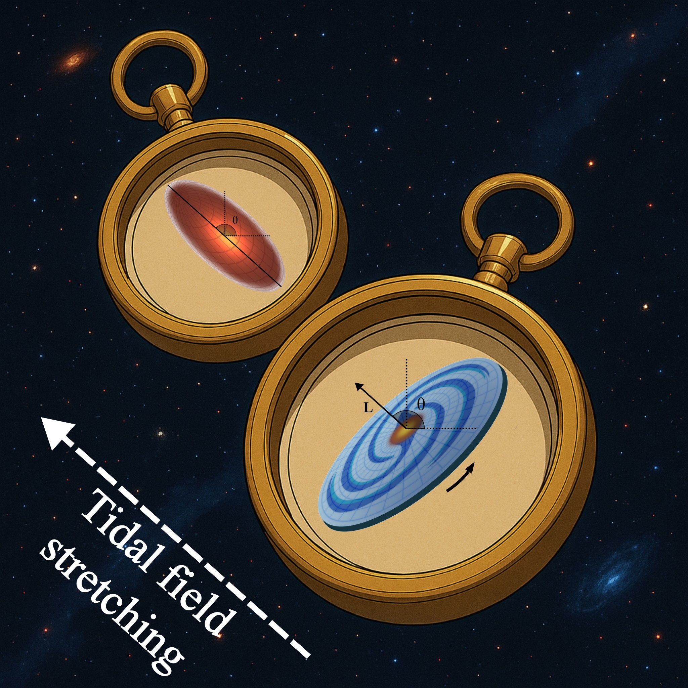

# LAIA — Large-Scale Axial Intrinsic Alignment

Public implementation of the **core LAIA estimator**, minimal signal-injection
mocks and reproducible examples.

**Version:** 0.2.0  
**Software DOI:** [10.5281/zenodo.24500241](https://doi.org/10.5281/zenodo.24500241)



## Download

- [Download the version 0.2.0 source archive](laia-0.2.0.tar.gz).
- [Zenodo software record](https://doi.org/10.5281/zenodo.24500241).

For version 0.2.0, use the files inside `laia-0.2.0.tar.gz`, rather than any
older source directories retained in this repository. The archive contains the
complete public package, full README, documentation, examples, automated tests
and toy-ensemble reference outputs. GitHub does not extract the archive into
browsable source folders.

## Installation

Download the archive, then run:

```bash
tar -xzf laia-0.2.0.tar.gz
cd laia-0.2.0

python -m venv .venv
source .venv/bin/activate
python -m pip install -e ".[plot,dev]"
```

Python 3.10 or newer is declared; validation was performed with Python 3.12.
All commands below are run from the extracted `laia-0.2.0` directory.

## Quickstart

```bash
python examples/quickstart.py --output example_output --plot
python examples/maps_to_measurement.py example_output/maps.fits --field a
```

The north--south-axis ensemble runs 64 simulations of 100,000 objects with
a 60-arcmin injected alignment:

```bash
OPENBLAS_NUM_THREADS=1 OMP_NUM_THREADS=1 \
python examples/quickstart.py --ensemble --output north_pole_output
```

It reports the mean and sample standard deviation of recovered amplitudes,
the standard error of the mean separately, and recovered-axis sky plots.
Axes are mapped to their northern antipodes; RA is shifted by 180 degrees
when an antipode is selected. These are controlled toy simulations, not survey
results or detection-significance estimates.

## Scope

The public package includes the core real-valued estimator, axial-direction
and angular-amplitude recovery, minimal mocks, FITS input/output, a spatial
block bootstrap, map-level PSF-template projection and optional complex-field
diagnostics.

It **does not include the complete survey-analysis pipeline** used for the
associated paper. Catalog selection, survey-specific calibration, empirical
and cosmological null ensembles, and significance analysis are not provided.
The mock generator is intentionally minimal, not a cosmological or
survey-realistic simulation.

After extraction, consult `README.md` and `docs/` for the full scientific
conventions, examples and limitations.

## Tests

From the extracted package directory:

```bash
python -m pytest -q tests
python -m ruff check laia estimator mock_generation examples tests
```

The public examples and tests do not require private survey data or the
separate local-validation bundle.

## Citation

Please cite both:

- Pedro da Silveira Ferreira et al.,
  [Where Galaxies Point: First Measurement of the Large-Scale Axial Intrinsic Alignment](https://arxiv.org/abs/2511.10005).
- LAIA software, version 0.2.0,
  [doi:10.5281/zenodo.24500241](https://doi.org/10.5281/zenodo.24500241).

Software citation metadata are provided in [CITATION.cff](CITATION.cff).

## License

LAIA is released under the [MIT License](LICENSE).
